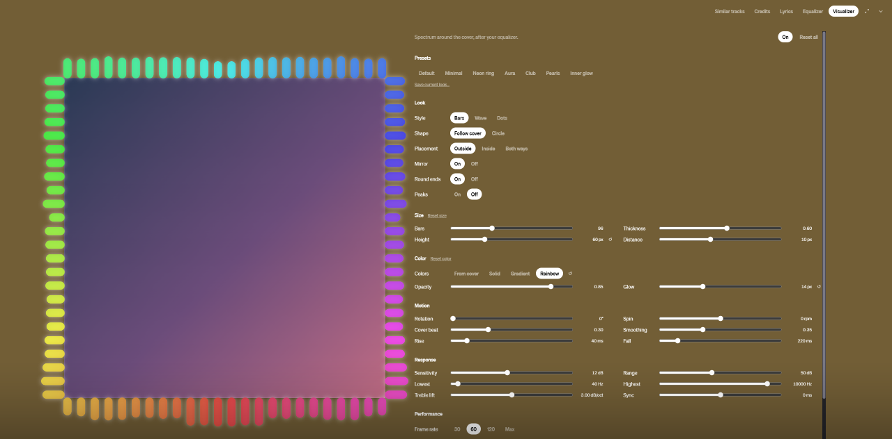
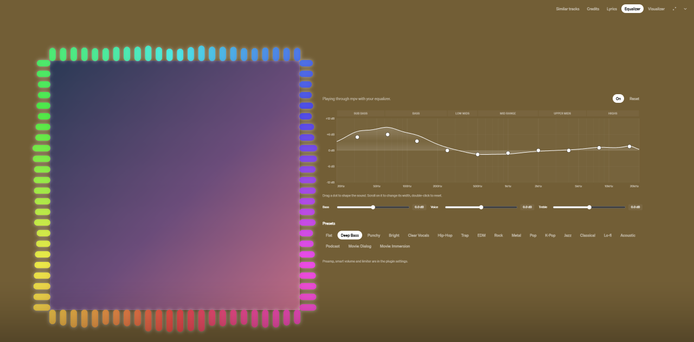

<h1 align="center">TidalEQ</h1>

<p align="center">A real equalizer inside TIDAL.</p>

TidalEQ is an equalizer plugin for [TidaLuna](https://github.com/Inrixia/TidaLuna). It adds **Equalizer** and **Visualizer** tabs next to Similar tracks, Credits and Lyrics in TIDAL's now-playing view, so you can shape the sound and see it without leaving the player.

<p align="center">
  
  
</p>
<p align="center"><sub>Cover art hidden in the screenshots.</sub></p>

## Install

1. Install [TidaLuna](https://github.com/Inrixia/TidaLuna).
2. Install [mpv](https://mpv.io/installation/). TidalEQ looks for it in `C:\Program Files\MPV Player\mpv.exe`; you can change the path in the plugin settings.
3. In TIDAL, open **Settings → Luna → Plugin Store**.
4. Paste this into **Install from URL**:

   ```
   https://github.com/BaeHyolyn/luna-plugins/releases/latest/download/store.json
   ```

5. Install **TidalEQ** from the store that appears.

TidalEQ works on Windows (it talks to mpv through a Windows named pipe).

Turn off TIDAL's exclusive mode: TidalEQ plays the audio itself, and exclusive mode would lock the output device.

## Features

- **Equalizer tab** in the now-playing view, with the same look as TIDAL's own tabs.
- **10 parametric bands** on a live frequency response graph. Drag a dot to change its frequency and gain, scroll to change its width, double-click to reset it. Each band can be a peak, low/high shelf or low/high-pass filter.
- **Bass, Voice and Treble** sliders for quick broad changes.
- **19 presets**: Deep Bass, Punchy, Bright, Clear Vocals, Hip-Hop, Trap, EDM, Rock, Metal, Pop, K-Pop, Jazz, Classical, Lo-fi, Acoustic, Podcast, Movie Dialog, Movie Immersion and Flat.
- **Preamp**, **smart volume** (evens out loud and quiet parts) and a **limiter** so boosts never clip.
- **Visualizer** around the cover: the real spectrum of what you hear, after your equalizer. Everything is adjustable live from its tab:
  - bars, wave, dots or stacked rainbow layers, with optional particles; a round cover the ring hugs; following the cover or in a circle; outside, inside or both ways; mirror; bar count, size and distance;
  - colors from the cover (up to 24, picked again automatically on every song, or placed by hand), solid, gradient or rainbow; opacity and glow;
  - rotation, spin, a cover that beats with the bass, rise/fall smoothing;
  - sensitivity, frequency range, treble lift, sync offset and frame rate.
- **Presets** for the visualizer, plus your own saved looks, and **Copy / Paste settings** to share them.
- Every setting can go back to its default on its own (↺ or double-click), per section, or all at once.
- **Keyboard:** Tab to an equalizer band, then the arrows move it (←→ frequency, ↑↓ gain), PageUp/PageDown change its width and Delete resets it; Shift makes bigger steps. Color points move with the arrows and Delete removes them.

## How it works

TIDAL's desktop app plays audio in a separate native player that plugins can't reach, so TidalEQ plays each track through [mpv](https://mpv.io) with your equalizer instead. TIDAL's own player keeps running silently, so the progress bar, queue, play/pause, seeking and volume all work as usual and mpv follows them. Videos are left to TIDAL.

The visualizer works with the equalizer on or off. A second, silent mpv decodes the track into samples (sharing the equalizer's download when it's on), and the spectrum follows what mpv plays, or TIDAL's own player when the equalizer is off. It still needs mpv installed.

If mpv can't start, TidalEQ tells you and TIDAL keeps playing normally.

## Build

```
pnpm install
pnpm run build
pnpm test
```

`pnpm run watch` serves the build on `http://127.0.0.1:3000` for Luna's dev store.

## License

[AGPL-3.0](LICENSE)
